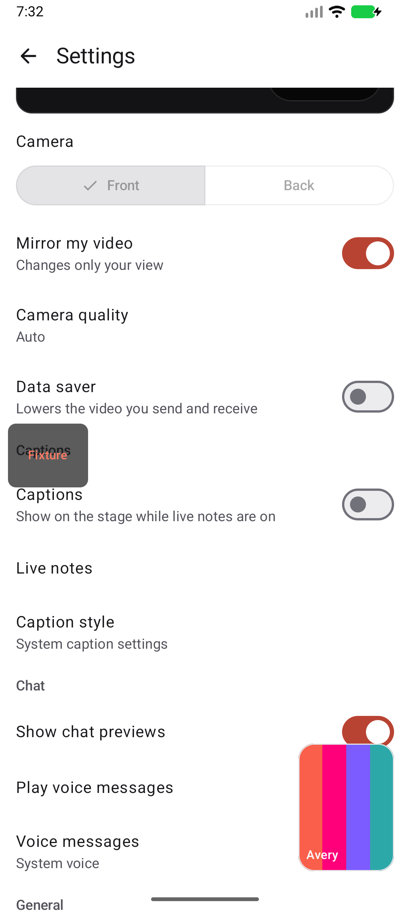
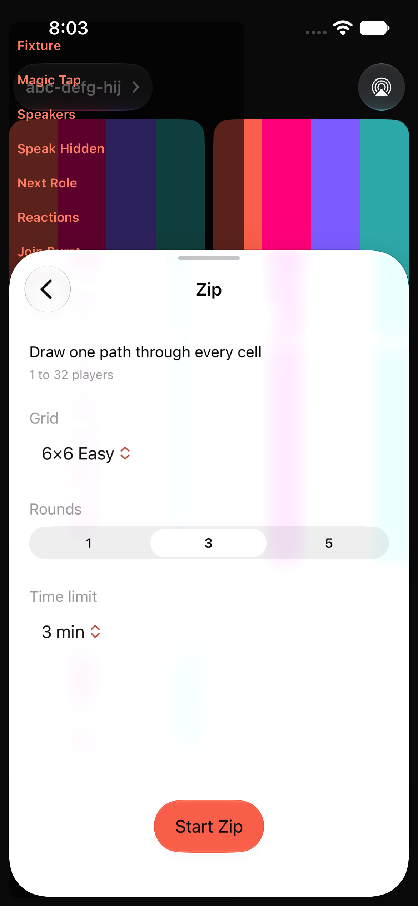

# Native owner polish verification, 2026-10-29

These unedited screenshots contain offline Debug fixtures only. The Fixture badge, diagnostic text and colored test tiles are not production UI. No owner-device content or credentials are included.

| Android Settings | iOS game setup |
| --- | --- |
|  |  |

Code tested at `c83259179cf994c07b90560215624157eca7b621`. The following evidence commit adds documentation only.

## Builds and tests

All sequential native gates passed: Swift build/test, Android Kotlin compilation/tests and Debug/Release packaging, iOS simulator Debug and unsigned device Release builds. Counts: 461 XCTest cases, 1,718 Swift Testing tests in 113 suites, and 492 Kotlin tests in 61 suites. Custom endpoint configuration probes and generated token/icon/embed checks passed. Android Release remains unminified; these local artifacts are not store-signed distribution builds.

- Android Debug APK SHA-256: `6bb29f3c92c5e760315197fc839ad8f6feee163efbf2472f2752caac5a90662b`. The fresh final APK is byte-identical to the one installed on spare emulator-5556.
- iOS Debug canonical bundle-tree SHA-256: `8d0dfd3ba953774d5ee7b2ae5b85840f417cccf6ef80d91ff6531a786650ed30`. The repaired candidate was installed on spare iPhone 17e, iOS 27.0.

## Manual checks

1. Open the `controls-guest` fixture, then More > Settings. Scroll through the camera/chat sections and final controls. Content continues beside the floating tile; the final controls remain reachable. Light/dark and a 1.5-scale landscape sample passed on Android.
2. Open the premeeting lobby fixture. Verify the larger preview, separate name and Sign In, icon-only media controls and floating primary action. On iOS, focus the name field and scroll Sign In clear of the translucent bottom edge while the keyboard remains present.
3. In the `chat-busy` fixture, use the recording-only voice driver. Idle, playing and stopped rows keep identical bounds; the fresh Stop control returns to Play on both platforms. No audio was synthesized or played.
4. In Transcript takeover, collapse Advanced and switch provider. Required key fields remain visible; optional model controls stay under Advanced. On iOS, the system share sheet opens for canned transcript data and cancels normally. No key, destination, save or copy action was used.
5. Open the activities fixture and select Zip. Rounds and the floating Start action fit in the ordinary partial sheet. Select 3, change iOS text size live from Large to AX5 and back, then rotate portrait/landscape/portrait. The same process keeps Zip open and preserves 3. Back and Close work. Start was not pressed.
6. The earlier iOS pass also checked solo/room-pill/raised-hand/toast presentation and the inline system Photos picker. The system privacy disclosure remains; no photo was selected.

The live text-size test initially exposed a navigation reset. The final fix keeps the sheet interaction modifier structurally stable. The same sequence then passed on the repaired candidate, including normal scrolling to reach the lower controls at AX5.

## Limits

Android docked-keyboard coverage was blocked because no on-screen IME appeared. Full simultaneous name/Sign In clearance in a compact iOS keyboard viewport remains inconclusive. This pass does not establish live media, minimum-OS, physical-device, performance or signed-release readiness. Owner devices were left untouched; spare settings were restored and owned app/device claims released.
