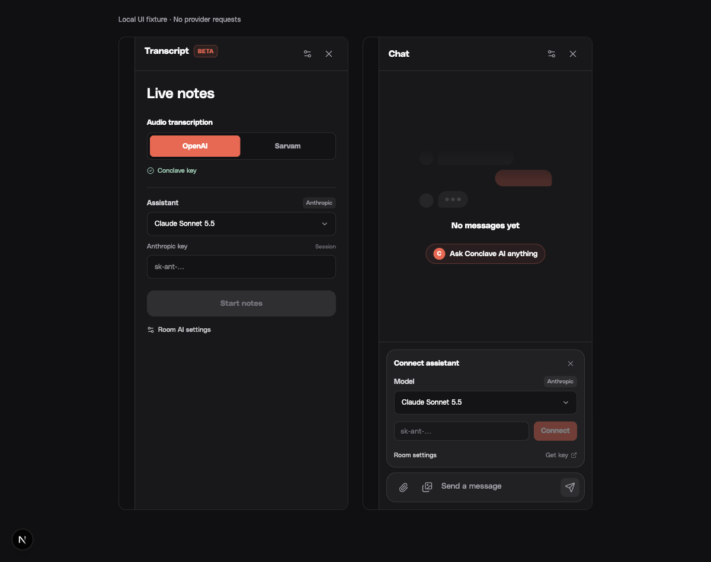
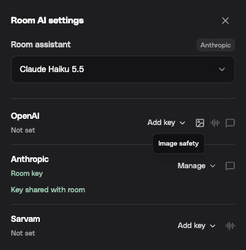
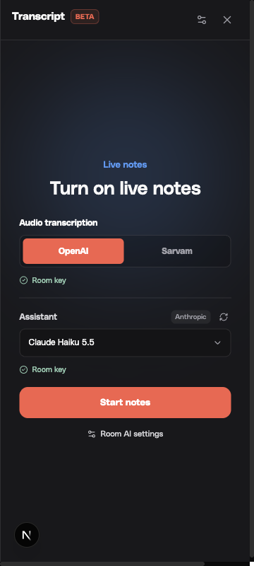
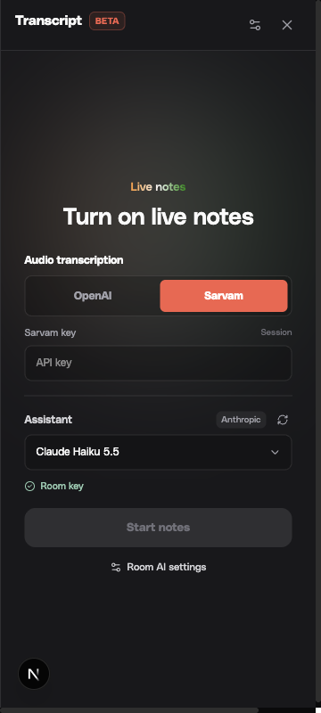
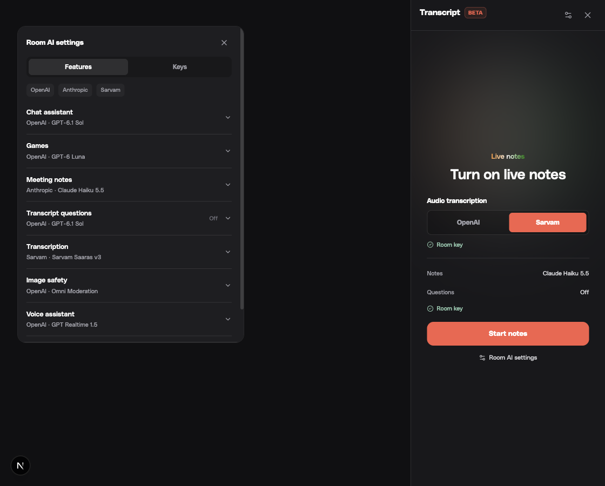
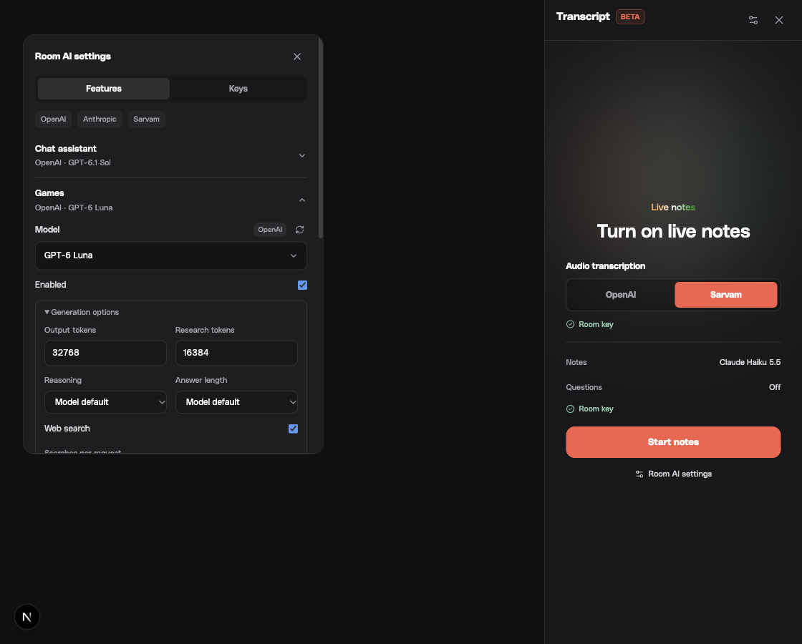

# AI providers and models

`@conclave/ai/models` is the browser-safe registry for provider labels, key links,
credentials, model capabilities, output budgets, and feature defaults.
`@conclave/ai/server` owns SDK construction, gateway URLs, retries, text generation,
structured outputs, streaming events, and provider-native tool conversation replay.
Import the server entry only from server or Worker code.

The web assistant, transcript Q&A and minutes, and SFU game generation use this
package. Realtime voice, ElevenLabs voice cloning/TTS, and image moderation use the same
provider/default/endpoint registry;
moderation also uses the shared OpenAI client factory. The native Swift/Skip app retains its existing OpenAI assistant picker; these
text alternatives are exposed in the web client and server configuration.
Audio transcription remains
OpenAI or Sarvam: Claude is a text alternative, not a realtime audio provider.

## Configuration

| Setting | Purpose |
| --- | --- |
| `OPENAI_API_KEY` | OpenAI text, transcription, and moderation credentials |
| `ANTHROPIC_API_KEY` | Claude text credentials |
| `SARVAM_API_KEY` | Sarvam transcription credentials |
| `ELEVENLABS_API_KEY` | ElevenLabs voice cloning and synthesis credentials |
| `CONCLAVE_ASSISTANT_MODEL` | Shared web chat model; defaults to `gpt-6.1-sol` |
| `SFU_GAME_AI_MODEL` | Initial game model; defaults to `gpt-6-luna` |
| `CLOUDFLARE_AI_GATEWAY_OPENAI_URL` / `OPENAI_BASE_URL` | OpenAI API base URL, gateway takes precedence |
| `CLOUDFLARE_AI_GATEWAY_ANTHROPIC_URL` / `ANTHROPIC_BASE_URL` | Anthropic API base URL, gateway takes precedence |

Model overrides must belong to supported response families; invalid deployment settings
fail instead of silently choosing another provider. The provider follows the model.
No request automatically fails over to another provider or credential. Explicit
participant credentials take precedence over shared credentials for chat. Transcript
sessions reuse their transcription key only when the response provider matches;
otherwise they need a separate assistant key or that provider's shared key.
Transcript Q&A and minutes reload room settings and provider credentials for each new request. Audio model changes apply after restarting notes.
Keys remain in live session memory and are never persisted in transcript storage.

Configure shared room provider keys, gateway/base URLs and
`CONCLAVE_ASSISTANT_MODEL` on the SFU. Routed web chat and notes retrieve this
authenticated profile for discovery and inference, so independent Worker keys
cannot select a different account or endpoint. Personal keys override the
credential while retaining the room's provider endpoint. A failed profile lookup
asks the participant to reconnect rather than using a different Worker's account.
Worker-local credentials remain available for standalone legacy flows without
signed SFU routing. Routed notes use room AI availability instead of the Worker's
independent key flags.

Transcript participants select their assistant model in the notes panel. To use
Claude for games, set `ANTHROPIC_API_KEY` and
`SFU_GAME_AI_MODEL=claude-haiku-5-5` on the SFU; both Compose services forward
these settings. Image moderation still requires the OpenAI key.

## Claude alternatives

Verified against the [Anthropic model catalog](https://platform.claude.com/docs/en/models/overview)
on October 22, 2026:

| Model ID | Use |
| --- | --- |
| `claude-haiku-5-5` | Fast summaries, simple questions, game content |
| `claude-sonnet-5-5` | Balanced meeting synthesis and tool use |
| `claude-opus-5-5` | More demanding synthesis and multi-step work |
| `claude-fable-5-1` | The most demanding reasoning workloads |

Claude keeps its native thinking defaults unless a room effort is selected. Explicit effort uses Anthropic output configuration; answer length uses an instruction instead of OpenAI verbosity fields. The adapter emits activity events for Claude thinking
and preserves signed thinking internally for tool continuation. Raw thinking is
not displayed. Web search uses Anthropic's basic server search tool, with up to
ten searches per request by default, configurable from one to thirty. Model availability and web search also depend on the
account's permissions.

Claude's [structured outputs](https://platform.claude.com/docs/en/build-with-claude/structured-outputs)
cannot share a response with citations. For structured game content with search
enabled, the adapter first gathers research, then makes a separate structured
request without search tools. This adds one request. Unsupported schema bounds
are carried in field descriptions; the existing minutes/game parsers still bound
and validate the results. Incomplete responses and provider errors fail the
request. Failed game generation shows an error without starting unrelated built-in content; a blank topic intentionally uses built-ins.

## Room keys

The web chat and notes panels expose room AI settings. Active participants can add
OpenAI, Anthropic, or Sarvam keys for everyone in that room. Only the contributor
or a host can replace/remove a contribution. Keys live in the owning SFU room's
private memory and are cleared on room close; socket snapshots contain only
provider availability and ownership. A server restart requires adding them again.
Deployment keys take precedence over room contributions. Compact Chat and Notes setup share keys with the room before starting; legacy explicit personal API credentials remain request/session scoped. Providers never share keys.

Room OpenAI keys cover image moderation and can also power text, games, and audio.
Moderation stays fail closed. The image button opens setup when a room lacks an
OpenAI key. Anthropic covers text; Sarvam covers audio. Games use their room feature model, initially inherited from the room choice or `SFU_GAME_AI_MODEL`; setting `SFU_GAME_AI_ENABLED=false` still disables generation.

The web server and transcript Worker retrieve selected credentials through the
SFU's private `/internal/ai/credentials` endpoint. It requires a server shared
secret and exact active room/client/channel/user identity. Web uses `SFU_SECRET`;
Worker uses `TRANSCRIPT_TOKEN_SECRET` (or the shared SFU secret). Configure
`SFU_PUBLIC_URL` (or `SFU_INSTANCE_URL`) on the SFU for signed transcript routing, and the same
`TRANSCRIPT_TOKEN_SECRET` on SFU and Worker. No arbitrary browser URL is accepted.
The browser-safe `@conclave/ai/room` entry contains metadata only; credential
retrieval lives in `@conclave/ai/room-server`.

Removing a room key affects new chat, game, minutes and Q&A requests. Active audio sessions retain their in-memory credential until stopped; borrowed keys are never persisted for automatic Worker recovery. Stop active notes or voice to revoke their current audio key immediately.

All game generation stages, including Claude research plus structured output, share the room feature deadline (ten minutes by default, up to thirty). The client acknowledgement allows that deadline. Hosts can cancel pending generation; duplicate starts are rejected and room closure or the requesting host leaving aborts the request.

## Updating models

Room settings, personal assistant setup and notes load account-specific models
from the OpenAI and Anthropic Models APIs through the owning SFU. Refresh reloads
the list; shared refreshes update the other room pickers too. Shared catalogs are
cached for five minutes per effective key and invalidated when keys change.
Personal-key discovery is not retained in room state. Socket replies contain model
metadata only, and membership is checked again after discovery completes.

OpenAI lists model IDs without endpoint/tool capabilities, so `src/models.ts`
limits discovery to supported general-purpose Responses families. Anthropic's
capability metadata additionally filters for structured outputs and web search.
Retired models are excluded, and aliases replace duplicate dated snapshots.
Newly discovered IDs are verified with the selected credential before inference;
successful selected-model checks are cached for one minute, scoped to provider,
endpoint, model and a credential fingerprint. Failed checks are not cached.
optional tuning uses provider defaults until documented. Known model profiles
continue to work when a key lacks model-list permissions. Discovery failures show
an explicit error and built-in choices; an unavailable selection stays visible
instead of silently switching models or providers.

Update supported families, feature budgets and defaults in `src/models.ts` when
provider APIs change. Keep the `meeting-core/transcript-models` re-export for existing clients.
Add a provider adapter behind `createAiTextSession` and `generateAiText` when
introducing a new text provider; product surfaces should not construct SDKs.

Run `pnpm check`. Provider tests use the real SDKs with fixture HTTP responses;
they do not spend provider credits or demonstrate live model availability.

## UI verification

Local fixture showing Claude selected in the existing notes and chat panels.
Desktop and narrow viewport checks used local fixtures; no live provider requests were made.

The notes setup retains its original blue spotlight and Sarvam tricolor treatment,
with separate audio and assistant controls. These captures use a local room and
fixture provider endpoints, without paid inference.

## Room models and provider diagnostics

Room AI settings have separate Features and Keys tabs. Each feature has an independent model and enabled state: chat, games, notes, transcript questions, transcription, image safety, realtime voice, and cloned speech. Text features additionally support output/research budgets, reasoning effort, answer length, web search and search count, custom instructions, and timeout. Audio APIs expose their applicable model and timeout options. Disabling image safety blocks uploads rather than accepting unreviewed images.

Text defaults are 32,768 output tokens and 16,384 research tokens. Budgets can be set from 128 to 128,000; discovered provider caps still apply. OpenAI reasoning consumes its response output budget; Claude's separate structured-output research pass uses the research budget. Choosing a budget does not guarantee that many tokens will be generated.

Only hosts or contributors of the effective provider key can change feature settings. Deployment-backed providers require a host. Chat tools `get_room_ai_settings` and `configure_room_ai` use the signed requester's exact live identity and the same SFU permission checks as socket settings. Tool results contain resolved configuration, never credentials. Changes affect new requests; active audio sessions need a restart. ElevenLabs speech configuration uses the existing web deployment credential; its key is not contributed through room settings.

The first compatible OpenAI or Anthropic contribution establishes initial text defaults. Per-feature changes remain independent. Removing a key leaves model selections visible. Explicit room feature models take precedence over older personal model selections. Room metadata is broadcast without keys and cleared with the room.

Assistant failures emit plain, redacted provider status, error type and request ID in Worker logs. The UI distinguishes rejected keys, model access, billing/credits and rate limits. This lets operators diagnose failed inference without recording API keys or request bodies.
